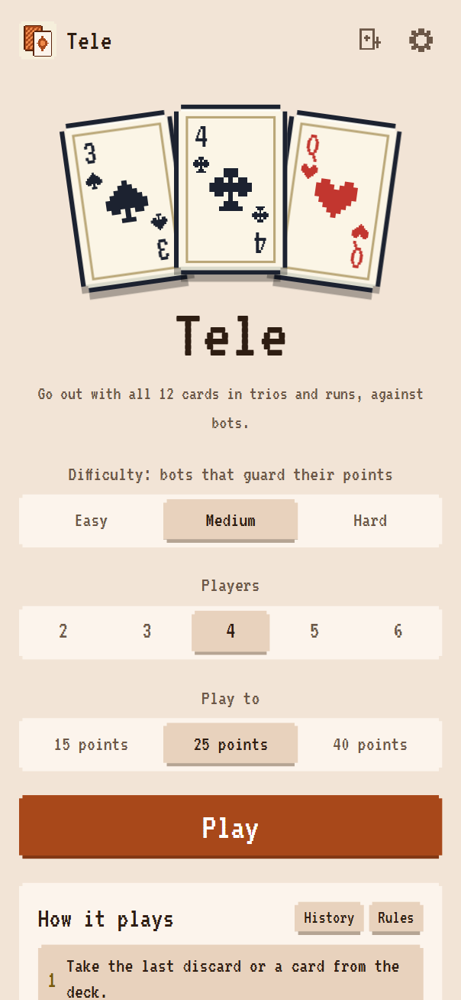
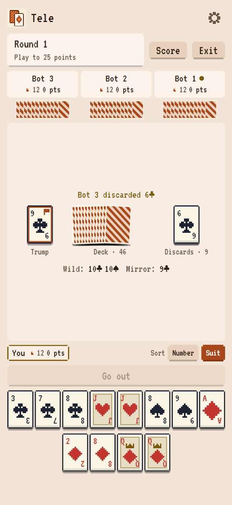
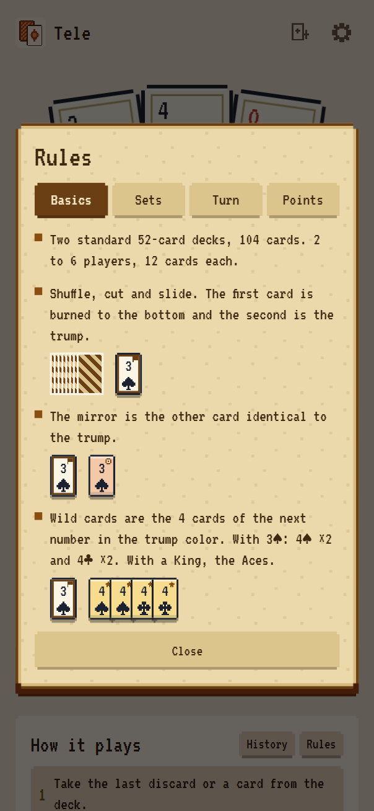
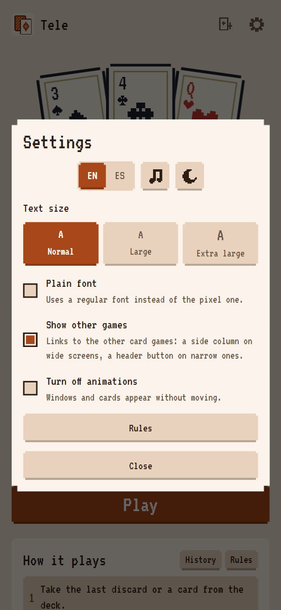

# Tele

Play Tele, the Chilean card game, on your phone or computer. Draw, discard and go out with all 12
cards in trios and runs before the bots do.

No account and no backend. Everything runs on your device, and your match is saved after every move.

<p align="center">
  
  
</p>

- **Players:** 2–6 (you against 1 to 5 bots)
- **Deck:** Two standard 52-card decks, 104 cards
- **Live:** https://tletelieru.github.io/tele/

## How it plays

| Step | What happens |
| --- | --- |
| Deal | The dealer is drawn at random and moves one seat right each round; the player to the dealer's right starts. 12 cards each. The first card is burned to the bottom, the second is the trump, face up |
| Wild cards | The 4 cards of the next number in the trump color. With 3♠: 4♠ and 4♣, two of each |
| Mirror | The other card identical to the trump |
| Turn | Take the last discard or a card from the deck. On the first turn, the first player may take the trump |
| Mirror discarded | It rests on the trump, and only the next player may take it |
| Go out | With 13 cards, if 12 form trios and runs, go out and cover with the 13th. If not, discard one |

Trios are 3 or more cards of the same number in any suit. Runs are 3 or more cards in a row of one
suit, and the Ace sits between the King and the 2, so Q-K-A-2-3 is a run.

| Points | Who |
| --- | --- |
| Going out: 3 | Whoever goes out |
| Each trio or run of 5+: 1 per card past the fourth | Everyone |
| Mirror: 1 | Everyone |
| Each wild card: 1 | Everyone |

First to the target (25 by default) wins. If several pass it, the highest total wins; on a tie,
whoever went out. The full rules are inside the game.

## What you get

- **Three difficulties:** Easy bots slip up, Medium bots guard their points and don't feed the next
  player, Hard bots count every discard and every card a rival picked up. No bot ever sees your cards
- **Hints only on Easy:** your sets are grouped in the hand and the cover cards are marked. On Medium
  and Hard you arrange your sets and pick the cover yourself
- **Your hand, your way:** drag cards to sort them, or sort by number or suit (and sets on Easy)
- **Two-tap play:** tap a card to raise it, tap it again to discard; same for the deck, the discard pile
  and the mirror on the trump. Go out always sits in a fixed bar above your hand
- **A real table:** a draw for who deals, the deck slid across the table, the top card burned under
  the slide and the next one turned up as the trump. Every card you or a bot takes or discards flies
  between the piles and the hands, and when the deck runs out the discards slide back into it. At the
  end of each round the covered card and every set are revealed one by one before the summary
- **Illustrated rules:** every rule comes with example cards
- **Chiptune music:** its own themes, written in code, with a switch to mute it
- **Trump, mirror and wild cards marked** on every card
- **Match history:** finished and abandoned matches, with the score of every round
- **Saved matches:** reload, close the tab or turn off your phone, and the match comes back

Settings has larger text sizes, a regular font instead of the pixel one and a switch to turn off
animations. It also comes in English and Spanish, with light and dark mode. Install it as an app and
it works offline.

<p align="center">
  
  
</p>

## How strong are the bots?

Each row is one bot against a table of the other, with the seat rotating every match. 4 players,
matches to 25.

| Bot | Against | Players | Matches | Wins | Even odds |
| --- | --- | --- | --- | --- | --- |
| Medium | Easy | 4 | 300 | 56.7% ±5.6 | 25% |
| Hard | Easy | 4 | 200 | 59.0% ±6.8 | 25% |
| Hard | Medium | 4 | 300 | 27.7% ±5.1 | 25% |

Going out fast matters most in Tele, so Medium and Hard share the same core. Hard's edge comes from
counting live cards when it is one or two cards away, which shows up as a small but steady lead.

## Run it locally

Requires Node 24 and pnpm 9.

```sh
pnpm install
pnpm dev        # http://localhost:5173/tele/
```

| Command | What it does |
| --- | --- |
| `pnpm test` | Runs the unit and property tests |
| `pnpm lint` | Runs ESLint |
| `pnpm typecheck` | Runs the type checks |
| `pnpm build` | Builds the app |
| `pnpm sim --hero hard --field medium --matches 200` | Plays bots against each other |

## How it works

| Folder | What lives there |
| --- | --- |
| `packages/engine` | Rules, legal moves, scoring and the meld solver, with no UI code |
| `packages/bots` | Easy, Medium and Hard |
| `apps/client` | The game, built with React, Tailwind and Vite |
| `apps/sim` | Command line tool for bot matches |

The engine is pure and serializable, so saved matches, the bots and a future online server all share
it. Bots only receive what their seat can see. Random matches check that no card is ever lost or
duplicated and that every round adds up by the table.

The meld solver splits a hand into trios and runs with wild cards in about a tenth of a millisecond.
It says whether 12 cards can go out and with which cover, finds the best scoring split and counts how
many cards a hand is from going out. Property tests compare it with a brute force search. The bots
run in a Web Worker, so the table never freezes. See [the development plan](docs/PLAN.md), in
Spanish, for what comes next.

## License

Copyright (c) 2026 tletelieru. All rights reserved. See [LICENSE](LICENSE).

---

Developed by [tletelieru](https://tletelieru.github.io/tletelieru/) · [GitHub](https://github.com/tletelieru)
